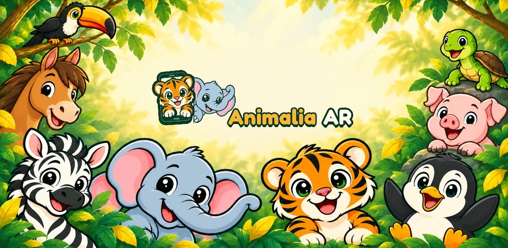
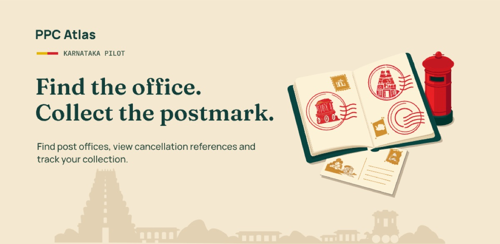
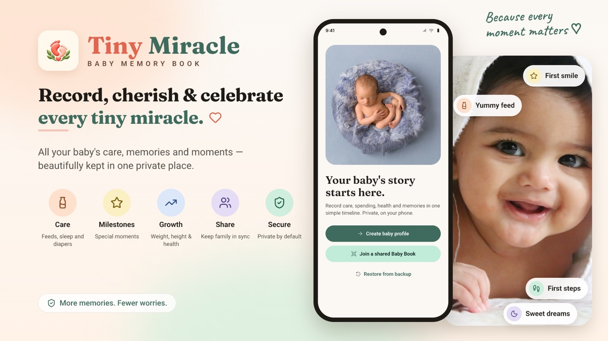
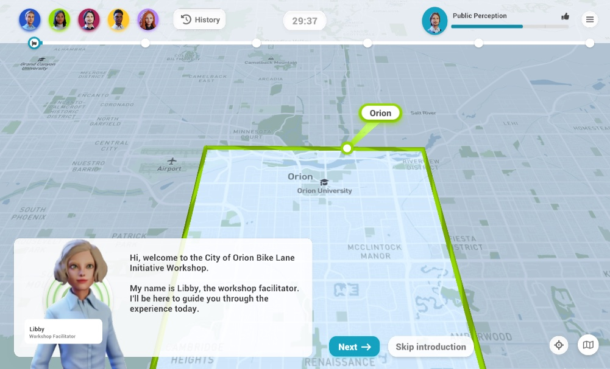

<div align="center">


# Madhu Sudhan R

### Senior Software Engineer · Independent App Developer

C#/.NET & WPF · Software Architecture · Android · Unity / XR

**Reliable software. Thoughtful products. Experiences worth building.**

[**Explore the portfolio**](https://madhurkms.github.io/) &nbsp; / &nbsp;
[LinkedIn](https://www.linkedin.com/in/madhu-sudhan-rkms/) &nbsp; / &nbsp;
[Get in touch](mailto:madhusudhan.r.dev@gmail.com)

---

</div>

## Engineering meets product craft

I'm a Senior Software Engineer with 7+ years of experience across healthcare,
automotive HMI, XR, and mobile. At L&T Technology Services, I support Philips,
focusing on C#/.NET, WPF, software architecture, and technical ownership.

Outside my role, I build and publish Android apps under **RKMS EMPIRE**.
I'm interested in generative AI and practical AI-assisted software development.

| Software engineering | Technical ownership | Product delivery |
| :--- | :--- | :--- |
| Reliable C#/.NET and WPF applications | Architecture and decisions from design through delivery | Android apps built, tested, and published on Google Play |

## Selected work

<table>
<tr>
<td width="50%" valign="top">

<a href="https://animalia-ar.web.app/">
  
</a>

### Animalia AR

Discover animals through interactive exploration and optional augmented reality.

**Unity · ARCore · Android**

[Google Play](https://play.google.com/store/apps/details?id=com.RKMSEMPIRE.AnimaliaAR) · [Project site](https://animalia-ar.web.app/)

</td>
<td width="50%" valign="top">

<a href="https://philatelypassport-5179b.web.app/">
  
</a>

### PPC Atlas

A companion for pictorial cancellation collectors: discover post offices, plan trips, and track a collection.

**Kotlin · Jetpack Compose · Room**

[Google Play](https://play.google.com/store/apps/details?id=com.rkmsempire.ppcatlas) · [Project site](https://philatelypassport-5179b.web.app/)

</td>
</tr>
<tr>
<td width="50%" valign="top">

<a href="https://tiny-miracle-book.web.app/">
  
</a>

### Tiny Miracle

A private, local-first baby memory book for milestones, care, health, spending, and documents.

**Kotlin · Jetpack Compose · Room**

[Google Play](https://play.google.com/store/apps/details?id=com.rkmsempire.tinymiraclebook) · [Project site](https://tiny-miracle-book.web.app/)

</td>
<td width="50%" valign="top">

<a href="https://geodesign.edpl.us/">
  
</a>

### The Workshop

A collaborative geodesign simulation exploring stakeholder perspectives and community planning.

**Arizona State University · WebGL**

[Visit the simulation](https://geodesign.edpl.us/)

</td>
</tr>
</table>

**More in the portfolio:** Accelerated Learning VR/MR samples and Titan Safety Training VR.

## About this website

A lightweight, responsive portfolio built with **HTML, CSS, and vanilla JavaScript**,
hosted on **GitHub Pages**. No framework, package installation, or build step required.

| Introduction | Experience | Projects |
| :--- | :--- | :--- |
| Hero, visual toolkit, and engineering strengths | Current-role card, expandable career history and education, and downloadable resume | Featured apps, full collection, category filters, and video samples |

**Designed for exploration:** a single scrolling page with anchor navigation,
responsive project layouts, and dedicated email and LinkedIn contact cards.
Video samples open in a keyboard-accessible dialog with native playback controls.

### Preview locally

From the repository root:

```sh
python3 -m http.server 8000
```

In VS Code, run **Simple Browser: Show** from the Command Palette and open
`http://localhost:8000`. Stop the server with `Ctrl+C` when finished.

### Project map

```text
index.html                 Page content and project cards
assets/
  css/style.css            Theme and responsive layouts
  js/script.js             Project filters and video dialog
  images/projects/         Project artwork
  videos/                  Browser-compatible H.264 samples
```

### Quick checks

```sh
node --check assets/js/script.js
git diff --check
```

Before publishing, check desktop and mobile layouts, anchor navigation, project
filters, expandable career history, contact links, and both video samples.
Verify that Escape closes the video dialog and restores focus to its trigger.
GitHub Pages publishes from the root of the `main` branch.

---

<div align="center">

**Thanks for visiting.**

[View the live portfolio](https://madhurkms.github.io/) · [Let's connect](https://www.linkedin.com/in/madhu-sudhan-rkms/)

</div>
